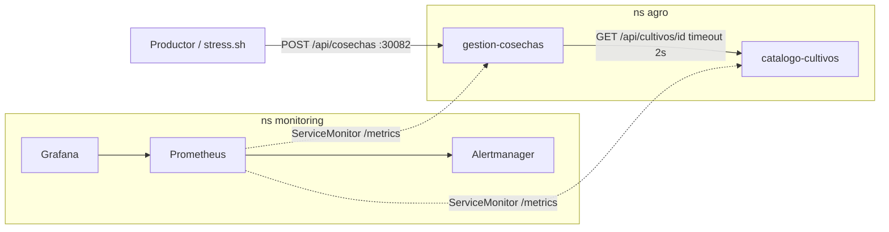

# Agro Monitoring — Kubernetes con Prometheus & Grafana

> **Entrega del curso Kubernetes con Prometheus & Grafana (Valle Grande).** Informe técnico: [docs/informe.md](docs/informe.md)

Dos microservicios Spring Boot del dominio agrícola desplegados en Minikube y observados
con `kube-prometheus-stack` (Prometheus, Alertmanager, Grafana).

| Servicio | Puerto | Qué hace |
|---|---|---|
| **catalogo-cultivos** (A) | 8081 | Catálogo maestro de cultivos: rendimiento esperado (kg/ha) y precio de mercado (S/ por kg). Soporta un retardo artificial con `RESPONSE_DELAY_MS`. |
| **gestion-cosechas** (B) | 8082 | Registra cosechas. Consulta a A (WebClient, timeout `CATALOGO_CULTIVOS_TIMEOUT_MS`), calcula si la cosecha **cumplió** el rendimiento esperado y su **ingreso estimado**. |



## URLs de acceso

Con el driver Docker de Minikube en Windows, la IP del nodo (`192.168.49.2`) **no es
accesible desde el navegador**. Por eso el cluster se crea con `--ports`, que publica los
NodePorts en `localhost`:

| Componente | URL | Credenciales |
|---|---|---|
| Grafana | http://localhost:30300 | `admin` / `AgroMonitoring2026!` |
| Dashboard | http://localhost:30300/d/agro-monitoring | |
| Prometheus | http://localhost:30900 (`/targets`, `/alerts`) | |
| Alertmanager | http://localhost:30903 | |
| catalogo-cultivos | http://localhost:30081/api/cultivos · `/metrics` · `/health` | |
| gestion-cosechas | http://localhost:30082/api/cosechas · `/metrics` · `/health` | |

## Inicio rápido

```bash
# Git Bash (Windows) o cualquier shell bash
./scripts/setup.sh          # levanta todo desde cero e imprime las URLs
./load-testing/stress.sh    # genera tráfico (ver -h)
./scripts/teardown.sh       # borra los recursos (añade --cluster para borrar el cluster)
```

## Instalación de prerequisitos (Windows, PowerShell)

```powershell
winget install --id Docker.DockerDesktop -e
winget install --id Kubernetes.minikube -e
winget install --id Kubernetes.kubectl -e   # Docker Desktop ya trae uno
winget install --id Helm.Helm -e
# abrir una terminal NUEVA para que tome el PATH, luego verificar:
docker version; minikube version; kubectl version --client; helm version
```

Versiones usadas: Docker 28.4.0, Minikube 1.38.1, kubectl 1.32.2, Helm 4.3.1,
Kubernetes 1.33.1, Java 17 (imagen) y Spring Boot 3.3.4.

**Memoria en Windows.** La VM de WSL2 que usa Docker Desktop crece sin límite y puede dejar
a Windows sin RAM, lo que se manifiesta como timeouts y probes fallando en el cluster.
Conviene limitarla en `%USERPROFILE%\.wslconfig`:

```ini
[wsl2]
memory=6GB
swap=4GB
[experimental]
autoMemoryReclaim=gradual
```

## Paso a paso manual (lo que hace `setup.sh`)

```powershell
# 1. Cluster: 8 CPUs, 4.5 GB, NodePorts publicados en localhost
minikube start --driver=docker --cpus=8 --memory=4608 --disk-size=30g `
  --kubernetes-version=v1.33.1 `
  --ports=30300:30300,30900:30900,30903:30903,30081:30081,30082:30082
minikube addons enable metrics-server

# 2. Stack de monitoreo
helm repo add prometheus-community https://prometheus-community.github.io/helm-charts
helm repo update
helm upgrade --install monitoring prometheus-community/kube-prometheus-stack `
  -n monitoring --create-namespace -f monitoring/values.yaml --wait

# 3. Imágenes dentro del daemon de Minikube
& minikube -p minikube docker-env --shell powershell | Invoke-Expression
docker build -t agro/catalogo-cultivos:1.0.0 microservices/catalogo-cultivos
docker build -t agro/gestion-cosechas:1.0.0  microservices/gestion-cosechas

# 4. Manifiestos
kubectl apply -f k8s/00-namespace.yaml -f k8s/catalogo-cultivos/ -f k8s/gestion-cosechas/ -f k8s/prometheus-rules.yaml
kubectl -n monitoring create configmap agro-monitoring-dashboard `
  --from-file=monitoring/dashboards/agro-monitoring-dashboard.json
kubectl -n monitoring label configmap agro-monitoring-dashboard grafana_dashboard=1
```

## Estructura del repositorio

```
microservices/
  catalogo-cultivos/        Servicio A (Spring Boot, Micrometer, Dockerfile multi-stage)
  gestion-cosechas/         Servicio B (WebClient hacia A, métricas de negocio)
k8s/
  00-namespace.yaml         namespace "agro" (separado de "monitoring")
  <servicio>/deployment.yaml   imagePullPolicy: Never, probes, requests/limits
  <servicio>/service.yaml      NodePort con puerto nombrado "http"
  <servicio>/servicemonitor.yaml
  gestion-cosechas/configmap.yaml
  prometheus-rules.yaml     8 alertas (disponibilidad, rendimiento, negocio agro)
monitoring/
  values.yaml               values propio de kube-prometheus-stack
  dashboards/agro-monitoring-dashboard.json   dashboard exportado (18 paneles)
  dashboards/generate_dashboard.py            generador del JSON
scripts/setup.sh · scripts/teardown.sh
load-testing/stress.sh      tráfico parametrizable (modos mixto, bajo-rendimiento, solo-palta, catalogo)
docs/
  casuistica-1-crashloop-config.md
  casuistica-2-servicio-lento.md
  casuistica-3-cultivo-eliminado.md
  informe.md                informe técnico (partes A–D)
  evidencias/               salidas reales de los comandos
```

## Métricas propias

| Métrica | Tipo | Servicio |
|---|---|---|
| `catalogocultivos_consultas_total` | Counter | A |
| `catalogocultivos_cultivos_creados_total` | Counter | A |
| `catalogocultivos_cultivos_registrados_actual` | Gauge | A |
| `catalogocultivos_delay_artificial_ms` | Gauge | A |
| `catalogocultivos_procesamiento_timer_seconds` | Timer (histograma) | A |
| `gestioncosechas_cosechas_registradas_total` | Counter | B |
| `gestioncosechas_cosechas_por_estado_total{estado=CUMPLIO\|POR_DEBAJO}` | Counter | B |
| `gestioncosechas_cosechas_rechazadas_total{motivo}` | Counter | B |
| `gestioncosechas_kg_rechazados_total{motivo}` | Counter | B |
| `gestioncosechas_ingreso_estimado_soles_total` | Counter | B |
| `gestioncosechas_catalogo_errores_total` | Counter | B |
| `gestioncosechas_cosechas_registradas_actual` | Gauge | B |
| `gestioncosechas_procesamiento_timer_seconds` | Timer (histograma) | B |

Además, Spring Boot expone `http_server_requests_seconds` (con histograma para calcular el
p95), y la JVM expone `jvm_*`.

## Alertas (`k8s/prometheus-rules.yaml`)

| Alerta | Tipo | Condición |
|---|---|---|
| `CatalogoCultivosCaido` | disponibilidad | ninguna instancia UP de A durante 1 min |
| `GestionCosechasCaido` | disponibilidad | ninguna instancia UP de B durante 1 min |
| `PodAgroEnCrashLoop` | disponibilidad | contenedor en CrashLoopBackOff |
| `CatalogoCultivosLento` | rendimiento | p95 de `/api` en A > 1 s |
| `TimeoutsHaciaCatalogo` | rendimiento | más de 0.05 errores/s de B hacia A |
| `CosechaSinRegistrarEnAcopio` | **negocio** | más de 5 t de cosecha rechazada en 5 min |
| `RendimientoBajoGeneralizado` | **negocio** | más del 50% de las cosechas por debajo del rendimiento esperado |
| `CultivoEliminadoDelCatalogo` | **negocio** | el catálogo maestro perdió cultivos en los últimos 10 min |
