# Informe técnico — Agro Monitoring

**Curso:** Kubernetes con Prometheus & Grafana — Valle Grande
**Sistema:** `catalogo-cultivos` (Servicio A) + `gestion-cosechas` (Servicio B) en Minikube,
observados con kube-prometheus-stack.

---

## Parte A — Conceptos

### 1. ¿Qué es Micrometer y por qué se usa en lugar de la librería directa de Prometheus?

Micrometer es una **fachada de métricas** para la JVM, algo así como lo que SLF4J es para los
logs. El código registra contadores, gauges y timers contra una interfaz neutral
(`MeterRegistry`), y un *registry* concreto los traduce al formato del backend. En mi
caso es `micrometer-registry-prometheus`, declarado en los dos `pom.xml`.

Razones para usarlo en vez del cliente directo de Prometheus:

- **No ato el código a un backend.** `CosechaMetrics` solo conoce `MeterRegistry`. Si
  mañana la cooperativa usa Datadog o CloudWatch, cambio la dependencia del registry y no
  toco ni una línea de Java.
- **Integración con Spring Boot Actuator.** Con solo añadir la dependencia obtengo gratis
  `http_server_requests_seconds` (latencia por endpoint, método y status), métricas de JVM
  (`jvm_memory_used_bytes`, `jvm_gc_pause_seconds`), de Tomcat y del proceso, todas expuestas
  en `/metrics`. Para que el endpoint quede en `/metrics` remapeé `management.endpoints.web.
  path-mapping.prometheus: metrics` en `application.yml`.
- **Convenciones automáticas.** Micrometer agrega el sufijo `_seconds` a los timers y
  `_total` a los counters, y aplica tags comunes. Por ejemplo, `management.metrics.tags.
  application` pone `application="gestion-cosechas"` en todas mis series.
- **Histogramas con una línea**: `.publishPercentileHistogram()` en el Timer de
  `CosechaMetrics` genera los buckets `_bucket{le=...}` que necesito para calcular el p95 en
  PromQL.

### 2. Diferencia entre Counter, Gauge y Timer (con ejemplos de mi código)

| Tipo | Qué representa | Cómo se mueve | Cómo se consulta |
|---|---|---|---|
| **Counter** | cuántas veces pasó algo | solo sube (vuelve a 0 si el pod se reinicia) | casi siempre con `rate()` o `increase()` |
| **Gauge** | el valor *actual* de algo | sube y baja | el valor tal cual |
| **Timer** | cuánto duró algo y cuántas veces ocurrió | publica `_count`, `_sum`, `_max` y, si hay histograma, `_bucket` | `rate(_sum)/rate(_count)` para el promedio, `histogram_quantile` para percentiles |

**Counter**: en `gestion-cosechas/.../metrics/CosechaMetrics.java` cuento los kilos de
cosecha que no se pudieron registrar, etiquetados por motivo:

```java
Counter.builder("gestioncosechas_kg_rechazados_total")
        .tag("motivo", motivo)          // catalogo_no_disponible | cultivo_inexistente
        .register(registry)
        .increment(cantidadKg);
```

No me interesa el valor absoluto, sino "cuántos kg por minuto estamos perdiendo", y eso lo
da `rate()`.

**Gauge**: en `catalogo-cultivos/.../metrics/CultivoMetrics.java`, el número de cultivos
que hay ahora en el catálogo maestro:

```java
registry.gauge("catalogocultivos_cultivos_registrados_actual", cultivosRegistrados);
// CultivoController lo actualiza al crear y al eliminar:
metrics.actualizarCultivosRegistrados(cultivos.size());
```

Baja cuando se elimina un cultivo, y justo eso detecta la alerta
`CultivoEliminadoDelCatalogo` (casuística 3). Con un Counter no se podría representar.

**Timer**: también en `CosechaMetrics`, el tiempo que tarda registrar una cosecha,
incluida la llamada al catálogo:

```java
this.procesamientoTimer = Timer.builder("gestioncosechas_procesamiento_timer")
        .publishPercentileHistogram()
        .register(registry);
// en CosechaController:
return metrics.getProcesamientoTimer().record(() -> { ... });
```

Un solo Timer me da la tasa (`_count`), la latencia media (`_sum/_count`) y el p95
(`_bucket`). En la casuística 2 este timer sube a ~2 s, porque cada request espera el
timeout hacia el catálogo.

### 3. ¿Qué es un ServiceMonitor y cómo sabe el Prometheus Operator qué monitorear?

Un **ServiceMonitor** es un recurso personalizado (CRD `monitoring.coreos.com/v1`) que
describe de forma declarativa *qué Services hay que scrapear y cómo*. Gracias a él no
tengo que editar `prometheus.yml` a mano.

La cadena completa en mi sistema es:

1. El **Prometheus** creado por el chart tiene `serviceMonitorSelector` y
   `serviceMonitorNamespaceSelector`, que dicen *qué ServiceMonitors* debe tomar. En mi
   `monitoring/values.yaml` ambos son `{}`: todos, en todos los namespaces.
2. Mi `k8s/gestion-cosechas/servicemonitor.yaml` (en el namespace `agro`) dice *qué
   Services* scrapear: `selector.matchLabels: app.kubernetes.io/name: gestion-cosechas`
   y `namespaceSelector.matchNames: [agro]`.
3. El **Service** `gestion-cosechas` tiene ese mismo label, y su puerto se llama `http`.
4. El ServiceMonitor apunta a `endpoints: - port: http, path: /metrics, interval: 15s`.
   Usa el **nombre** del puerto, no el número, por eso el Service lo nombra.
5. El **operador** observa estos recursos, resuelve Service → Endpoints → IPs de los pods,
   genera la configuración de scrape y recarga Prometheus. En `/targets` aparece
   `serviceMonitor/agro/gestion-cosechas/0` con la IP del pod.

Como se descubren los Endpoints y no los pods sueltos, Prometheus scrapea solo pods
**Ready**. Por eso, cuando un pod entra en CrashLoopBackOff, su target desaparece en vez de
marcar `up=0`, y mis alertas de caída usan `or vector(0)` (casuística 1).

### 4. Diferencia entre liveness probe y readiness probe

- **Liveness**: "¿el proceso está vivo o colgado sin remedio?" Si falla `failureThreshold`
  veces, el kubelet **reinicia el contenedor**.
- **Readiness**: "¿puede recibir tráfico ahora mismo?" Si falla, el pod **se saca de los
  Endpoints del Service** (no recibe requests ni es scrapeado), pero **no se reinicia**.

En mis Deployments:

```yaml
startupProbe:   { httpGet: { path: /health/liveness,  port: http }, periodSeconds: 5, failureThreshold: 24 }
livenessProbe:  { httpGet: { path: /health/liveness,  port: http }, periodSeconds: 10, timeoutSeconds: 2, failureThreshold: 3 }
readinessProbe: { httpGet: { path: /health/readiness, port: http }, periodSeconds: 5,  timeoutSeconds: 2, failureThreshold: 3 }
```

Usan los grupos de salud de Spring Boot (`management.endpoint.health.probes.enabled: true`).
Tres decisiones de diseño que tomé:

- La **readiness de gestion-cosechas no depende del catálogo**. Si A cae y B se marcara no
  Ready, también dejaría de servir `GET /api/cosechas`, y la falla se propagaría en
  cascada. Prefiero que B siga arriba y responda un 503 controlado al registrar.
- La **startupProbe** da hasta 2 minutos al arranque de la JVM antes de que empiece a contar
  la liveness. Sin ella, una liveness agresiva mataría al pod en pleno arranque, en un bucle
  sin fin.
- En la casuística 2 el retardo artificial solo afecta a `/api/*`, no a `/health`. Las
  probes siguen en verde mientras el negocio está roto: una probe verde no garantiza que el
  servicio funcione bien.

Además, en el arranque de B uso readiness como compuerta: precaliento el WebClient en un
listener de `ApplicationReadyEvent`. Spring publica `ReadinessState.ACCEPTING_TRAFFIC` justo
después de esos listeners, así que el pod no recibe tráfico hasta que el cliente está
caliente. Antes, la primera cosecha tras cada arranque se rechazaba por timeout.

### 5. ¿Por qué es necesario apuntar Docker al daemon de Minikube antes de construir las imágenes?

Minikube tiene **su propio daemon de Docker** dentro del nodo, separado del de Docker
Desktop en Windows. El kubelet del nodo solo ve las imágenes de ese daemon interno. Si
construyo `agro/gestion-cosechas:1.0.0` en el Docker de Windows, la imagen existe en mi
máquina pero **no dentro del nodo**.

```powershell
& minikube -p minikube docker-env --shell powershell | Invoke-Expression
# DOCKER_HOST=tcp://127.0.0.1:61872  -> el docker CLI ahora habla con el daemon del nodo
docker build -t agro/gestion-cosechas:1.0.0 microservices/gestion-cosechas
```

Esto va de la mano con `imagePullPolicy: Never` en los Deployments: le dice a Kubernetes
"usa la imagen local, no intentes descargarla". Si me olvido del `docker-env`, el pod queda
en `ErrImageNeverPull`. Si en cambio pusiera `Always` o `IfNotPresent` con un tag que no está
en el nodo, intentaría bajar `agro/gestion-cosechas` de Docker Hub y terminaría en
`ImagePullBackOff`. Así me ahorro montar un registry.

Hay una consecuencia práctica que resolví en `setup.sh`: como reconstruyo con el **mismo
tag** `1.0.0`, Kubernetes no detecta el cambio. Por eso el script hace `kubectl rollout
restart` cuando los Deployments ya existían.

### 6. ¿Qué ocurre si no configuras el selector de ServiceMonitors en el values.yaml del chart?

Por defecto, kube-prometheus-stack crea el Prometheus con
`serviceMonitorSelectorNilUsesHelmValues: true`, y el selector queda como
`matchLabels: { release: monitoring }` (el nombre del release de Helm). Entonces
**Prometheus solo toma los ServiceMonitors que tengan el label `release: monitoring`**, es
decir, los que trae el propio chart. Mis ServiceMonitors no tienen ese label, así que se
**ignoran en silencio**: no hay ningún error, simplemente no aparecen en `/targets` y los
dashboards quedan vacíos.

Lo mismo pasa con `ruleSelector`: sin configurarlo, mi `PrometheusRule` no se carga y las
alertas nunca disparan.

En mi `monitoring/values.yaml`:

```yaml
prometheus:
  prometheusSpec:
    serviceMonitorSelectorNilUsesHelmValues: false
    serviceMonitorSelector: {}            # cualquier ServiceMonitor...
    serviceMonitorNamespaceSelector: {}   # ...de cualquier namespace (agro incluido)
    ruleSelectorNilUsesHelmValues: false
    ruleSelector: {}
    ruleNamespaceSelector: {}
```

La alternativa habría sido añadir `release: monitoring` a cada ServiceMonitor y cada
PrometheusRule. Funciona, pero acopla mis manifiestos al nombre del release de Helm.

---

## Parte B — PromQL

Todas las consultas las ejecuté contra el Prometheus del cluster (http://localhost:30900).
Los resultados de ejemplo están en [evidencias/promql.txt](evidencias/promql.txt).

### 1. Tasa de requests por minuto del Servicio B en los últimos 5 minutos

```promql
sum(rate(http_server_requests_seconds_count{namespace="agro", job="gestion-cosechas", uri=~"/api/.*"}[5m])) * 60
```

`rate(...[5m])` da requests por segundo, promediadas en 5 minutos, y `* 60` las pasa a
requests por minuto. Filtro `uri=~"/api/.*"` para excluir los scrapes de `/metrics` y las
probes de `/health`, que no son tráfico de negocio. Variante por endpoint y código de
respuesta: `sum by (method, uri, status) (...) * 60`.

### 2. Latencia p95 del endpoint más crítico

El endpoint más crítico es `POST /api/cosechas`: es el único que depende de otro servicio
(consulta el catálogo con timeout de 2 s) y es donde se pierde dinero si falla.

```promql
histogram_quantile(0.95,
  sum by (le) (rate(http_server_requests_seconds_bucket{namespace="agro", job="gestion-cosechas", method="POST", uri="/api/cosechas"}[5m]))
)
```

El `sum by (le)` es obligatorio: `histogram_quantile` necesita los buckets agregados
conservando la etiqueta `le`. Los buckets existen porque activé
`management.metrics.distribution.percentiles-histogram.http.server.requests: true`.

### 3. Estado UP/DOWN de ambos servicios al mismo tiempo

```promql
up{namespace="agro", job=~"catalogo-cultivos|gestion-cosechas"}
```

Devuelve una serie por servicio, con valor 1 (UP) o 0 (DOWN). Esta consulta tiene un
punto ciego: si un servicio está en CrashLoopBackOff, su serie **desaparece** en vez de
valer 0. La versión robusta, la que usa el dashboard, devuelve siempre las dos filas:

```promql
sum by (job) (up{namespace="agro", job="catalogo-cultivos"}) or label_replace(vector(0), "job", "catalogo-cultivos", "", "")
or
sum by (job) (up{namespace="agro", job="gestion-cosechas"})  or label_replace(vector(0), "job", "gestion-cosechas",  "", "")
```

### 4. Pregunta de negocio: ¿cuántos kilos de cosecha llegaron al acopio en la última hora sin poder registrarse, y por qué?

```promql
sum by (motivo) (increase(gestioncosechas_kg_rechazados_total{namespace="agro"}[1h]))
```

Cada kilo rechazado es producto que el productor entregó pero que no queda registrado, así
que no se le paga ni se factura. `motivo` separa el problema técnico
(`catalogo_no_disponible`: caídas o timeouts del catálogo) del de datos maestros
(`cultivo_inexistente`: cultivo borrado del catálogo, casuística 3). Esta consulta es la base
de la alerta `CosechaSinRegistrarEnAcopio`.

Consultas de negocio complementarias que uso en el dashboard:

```promql
# % de cosechas que no alcanzaron el rendimiento esperado (kg/ha) en los últimos 10 min
sum(increase(gestioncosechas_cosechas_por_estado_total{namespace="agro", estado="POR_DEBAJO"}[10m]))
  / sum(increase(gestioncosechas_cosechas_por_estado_total{namespace="agro"}[10m]))

# ingreso estimado (S/) de las cosechas registradas en la última hora
sum(increase(gestioncosechas_ingreso_estimado_soles_total{namespace="agro"}[1h]))
```

---

## Parte C — Evidencias de casuísticas

Las tres casuísticas se ejecutaron sobre el sistema real, con tráfico de fondo generado por
`load-testing/stress.sh`. El detalle completo de cada una está en `docs/casuistica-*.md` y la
salida cruda de los comandos en `docs/evidencias/`.

| # | Casuística | Tipo de falla | Alertas que disparó |
|---|---|---|---|
| 1 | Error de configuración → CrashLoopBackOff | el servicio **cae** | `GestionCosechasCaido`, `PodAgroEnCrashLoop` |
| 2 | Servicio lento → timeouts en cascada | el servicio **vive pero tarda** | `CatalogoCultivosLento`, `TimeoutsHaciaCatalogo`, `CosechaSinRegistrarEnAcopio` |
| 3 | Cultivo eliminado del catálogo | el sistema **está sano y pierde dinero** | `CosechaSinRegistrarEnAcopio`, `CultivoEliminadoDelCatalogo` |

### Casuística 1 — Servicio caído por error de configuración (CrashLoopBackOff)

**Contexto.** Es lunes de campaña grande de papa. Un operador edita el ConfigMap
`gestion-cosechas-config` para dar más margen a la consulta al catálogo y, en vez de `2000`,
escribe `dos-mil`. No pasa nada en ese momento: el pod en ejecución ya leyó su configuración y
sigue sano. Horas después el pod se reinicia (un nodo que se drena, un OOM, un escalado) y el
reemplazo ya no consigue arrancar. Desde ese momento ningún productor puede registrar su cosecha.
El error y la caída están separados en el tiempo, y eso es lo que lo hace difícil de rastrear.

**Comandos de activación.**

```bash
kubectl -n agro patch configmap gestion-cosechas-config --type merge \
  -p '{"data":{"CATALOGO_CULTIVOS_TIMEOUT_MS":"dos-mil"}}'
kubectl -n agro delete pod -l app.kubernetes.io/name=gestion-cosechas   # el reinicio que detona el error
```

**Captura de Grafana con la anomalía.** `gestion-cosechas` aparece en **CAIDO** (rojo),
`Reinicios de pods` sube a 6, `Alertas agro FIRING` marca 2 y el tráfico de gestion-cosechas
cae a cero.

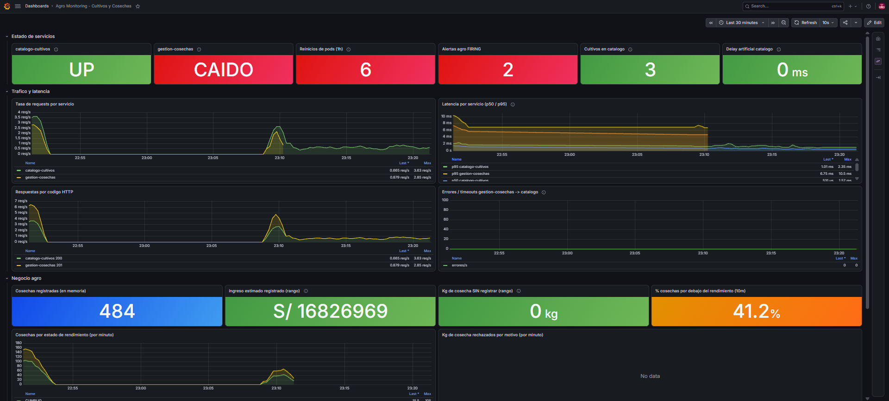

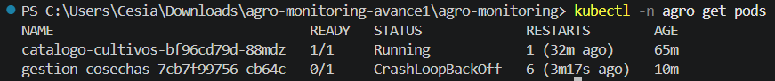

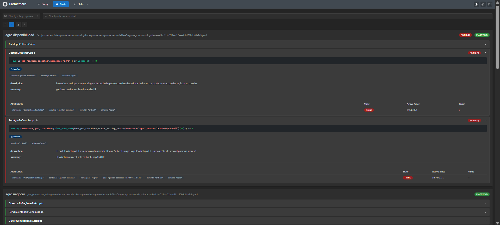

**Diagnóstico.** La alerta `PodAgroEnCrashLoop` identifica el pod. El log del contenedor
anterior da la causa exacta:

```text
$ kubectl -n agro logs -l app.kubernetes.io/name=gestion-cosechas --previous | grep "Failed to convert"
Failed to convert value of type 'java.lang.String' to required type 'int'; For input string: "dos-mil"
```

Las alertas llegaron a FIRING unos 108 segundos después de reiniciar el pod.

**Comando de resolución.**

```bash
kubectl -n agro patch configmap gestion-cosechas-config --type merge \
  -p '{"data":{"CATALOGO_CULTIVOS_TIMEOUT_MS":"2000"}}'
kubectl -n agro rollout restart deployment/gestion-cosechas
```

El pod nuevo quedó `1/1 Running` en unos 18 segundos y las alertas se apagaron en ~2 minutos.

**Lección.** Lo que más me sorprendió es que el error no apareció cuando edité el ConfigMap,
sino mucho después, cuando el pod se reinició. Kubernetes no revisa lo que escribes en un
ConfigMap ni reinicia los pods cuando cambia, así que un valor mal puesto queda dormido hasta
el siguiente reinicio, y ahí cae el servicio. De esta casuística me llevo tres cosas:

1. Cuando un pod está en CrashLoopBackOff, el comando que da la respuesta es
   `kubectl logs --previous`, porque muestra el log del contenedor que murió. En mi caso decía
   `For input string: "dos-mil"`.
2. Una alerta de "servicio caído" no puede depender solo de `up == 0`. Un pod que no está Ready
   sale de los Endpoints y su métrica desaparece en vez de valer 0. Por eso mi regla usa
   `(sum(up{...}) or vector(0)) == 0`.
3. Para evitarlo, la configuración debería estar en Git y validarse al arrancar la aplicación,
   para que falle enseguida y con un mensaje claro.

---

### Casuística 2 — Servicio lento y timeouts en cascada

**Contexto.** Es plena cosecha y el acopio recibe camiones todo el día. `catalogo-cultivos`
empieza a responder lento (una consulta pesada, un disco saturado o una dependencia degradada).
El catálogo sigue vivo y sano, solo que tarda 3 segundos. Como `gestion-cosechas` solo espera
2 segundos por la respuesta, se rinde en cada request y rechaza la cosecha. Un problema de
rendimiento en un servicio se convierte en pérdida de negocio en el otro, sin que ninguno esté
"caído".

**Comando de activación.**

```bash
kubectl -n agro set env deployment/catalogo-cultivos RESPONSE_DELAY_MS=3000
```

**Captura de Grafana con la anomalía.** El panel `Delay artificial` marca 3 s, el p95 del
catálogo sube a ≈ 3.2 s y el de gestion-cosechas se aplana en ≈ 2.1 s (su propio timeout), los
errores hacia el catálogo suben a ≈ 4 por segundo y `Kg de cosecha SIN registrar` pasa a rojo.
Ambos servicios siguen en **UP**.

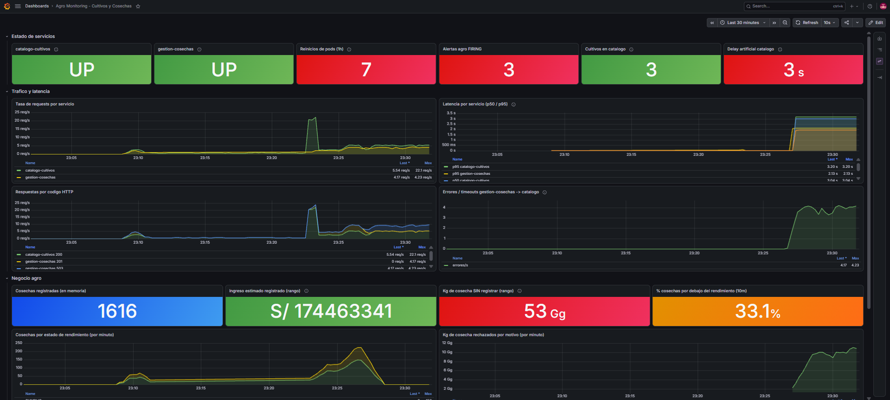

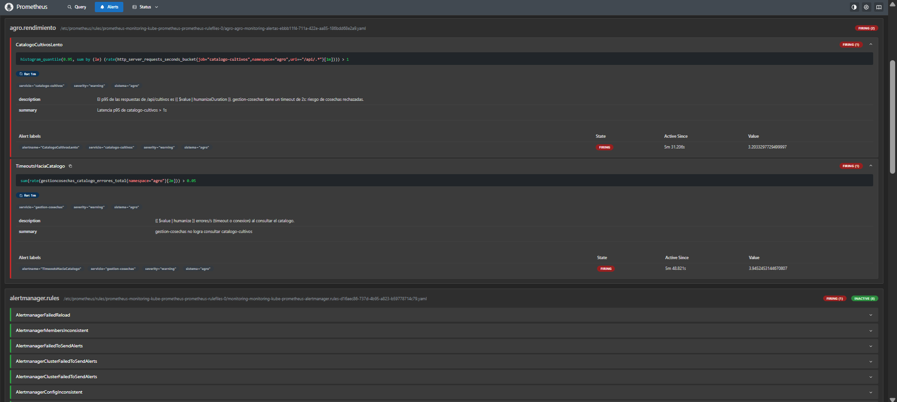

**Diagnóstico.** Los pods están Running y Ready: las probes miden `/health` y no ven la
lentitud. Lo que delató el problema fue la latencia p95 y el contador de errores hacia el
catálogo. Una medición directa lo confirma:

```text
$ curl -s -o /dev/null -w "%{time_total}s" http://localhost:30081/api/cultivos/1
3.279s
$ kubectl -n agro exec deploy/catalogo-cultivos -- printenv RESPONSE_DELAY_MS
3000
```

Pistas útiles: la latencia de gestion-cosechas quedó plana en ≈ 2 s, un valor redondo que
corresponde a su timeout, no a su velocidad real. Las alertas llegaron a FIRING en ~104 s.

**Comando de resolución.**

```bash
kubectl -n agro set env deployment/catalogo-cultivos RESPONSE_DELAY_MS=0
```

La respuesta del catálogo bajó de 3.28 s a 5 ms.

**Lección.** En esta casuística ningún servicio estaba caído y, aun así, B no podía registrar
ni una sola cosecha. Entendí que la lentitud también es una forma de caída: si A tarda 3
segundos y B solo espera 2, para B es como si A no existiera. B no tenía ningún defecto, el
problema de A se le contagió. Lo que me llevo:

1. Hay que mirar el **p95** y no solo el promedio, y desconfiar cuando una latencia se queda
   plana en un número redondo. El p95 de B se pegó en ≈ 2 s, que era justo su propio timeout.
2. Las **probes no detectan esto**: revisan `/health`, no `/api`, y por eso los pods seguían
   Running y Ready. Si además hubiera hecho que la readiness de B dependiera de A, habría sacado
   a B del Service y empeorado el incidente. La lentitud se detecta con métricas y alertas.
3. Para mejorarlo pondría una caché de cultivos en B (cambian muy poco) y un circuit breaker
   para fallar rápido en vez de esperar 2 s en cada request.

---

### Casuística 3 (propia) — Cultivo eliminado del catálogo: todo en verde, pero se pierde la cosecha

**Contexto.** Estamos en el pico de la campaña de palta Hass. Los camiones llegan al acopio con
fruta ya cosechada que debe pesarse, registrarse, pagarse y facturarse el mismo día, porque la
palta madura y se pierde. Un operador limpia el catálogo maestro y, creyendo que es un
duplicado, elimina la Palta Hass. No hay ningún error técnico: el catálogo responde con un 204
y ninguna probe falla. Pero desde ese instante cada cosecha de palta recibe un 404 y es
rechazada: el productor ya entregó la fruta y el sistema no la reconoce, así que no se registra,
no se paga ni se factura. Elegí este escenario porque simula una pérdida de negocio real que
ninguna métrica de infraestructura puede ver.

**Comando de activación.**

```bash
./load-testing/stress.sh -d 900 -m solo-palta -r 3 &   # tráfico solo de palta
curl -X DELETE http://localhost:30081/api/cultivos/3    # HTTP 204
```

**Captura de Grafana con la anomalía.** Es la imagen más ilustrativa del proyecto: los dos
servicios están **UP en verde**, sin reinicios nuevos y con latencia normal, mientras que
`Cultivos en catalogo` baja de 3 a 2 (naranja) y `Kg de cosecha SIN registrar` se pone en rojo.
El panel de kg rechazados por motivo muestra la causa. Los errores hacia el catálogo están en 0
porque el catálogo responde bien.

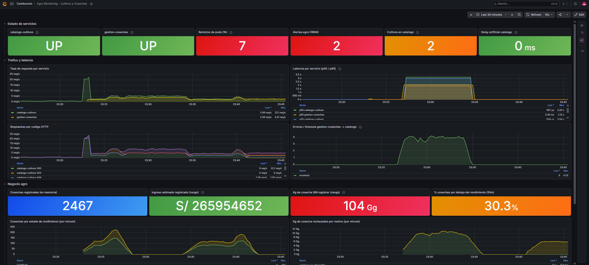

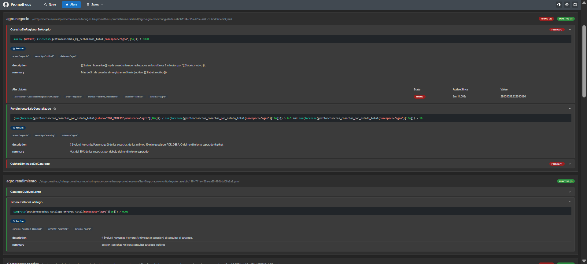

**Diagnóstico.** Lo primero fue descartar un problema técnico (pods sanos, targets UP, cero
errores entre servicios). Después, reproducir el error con una cosecha real:

```text
$ curl -s -X POST http://localhost:30082/api/cosechas -H "Content-Type: application/json" \
    -d '{"cultivoId":3,"hectareasCosechadas":2,"cantidadKg":24000}'
{"cultivoId":3,"error":"El cultivo id=3 no existe en catalogo-cultivos"}   HTTP 404
```

Fue diagnosticable porque el Servicio B distingue un 404 (el cultivo no existe) de un fallo de
comunicación (503) y lo etiqueta en la métrica `gestioncosechas_kg_rechazados_total{motivo=...}`.
Las alertas de negocio llegaron a FIRING unos 96 segundos después del borrado.

**Comando de resolución.**

```bash
kubectl -n agro rollout restart deployment/catalogo-cultivos   # vuelve a sembrar los 3 cultivos
```

No bastaba con crear la palta de nuevo: el catálogo guarda sus datos en memoria y le habría
asignado el id 4, mientras las cosechas siguen apuntando al id 3. Tras el reinicio, el
`POST /api/cosechas` con `cultivoId=3` devolvió HTTP 201.

**Lección.** Esta es la casuística que más me hizo pensar, porque en Grafana todo estaba en
verde (servicios UP, sin reinicios nuevos, latencia normal) y aun así se rechazaban todas las
cosechas de palta. Aprendí que "sano" no es lo mismo que "funcionando para el negocio": solo las
métricas de negocio (kg sin registrar, cultivos en el catálogo) mostraron el problema. Lo que me
llevo:

1. Las alertas de negocio deben hablar en unidades del negocio (toneladas sin registrar en
   5 minutos) y no en tasas de error, porque eso es lo que entiende quien recibe la alerta.
2. Etiquetar las métricas por causa (`motivo`) me permitió distinguir en pocos minutos un cultivo
   borrado (`cultivo_inexistente`) de un catálogo caído (`catalogo_no_disponible`).
3. Los datos maestros no deberían poder borrarse sin poder deshacerlo (borrado lógico, permisos).
4. Mi catálogo en memoria es frágil: volver a crear la palta le habría dado el id 4 y las
   cosechas habrían seguido fallando con el id 3. Tuve que reiniciar el pod para recuperar el
   id original. Con una base de datos y backups, la restauración conservaría los ids.

---

## Parte D — Evidencias del sistema

### D1. Targets en Prometheus (`/targets`) con ambos servicios UP

Prometheus descubrió los dos servicios a través de sus ServiceMonitors
(`serviceMonitor/agro/catalogo-cultivos/0` y `serviceMonitor/agro/gestion-cosechas/0`), y
ambos están en estado **UP** con el scrape de `/metrics` respondiendo en pocos milisegundos.

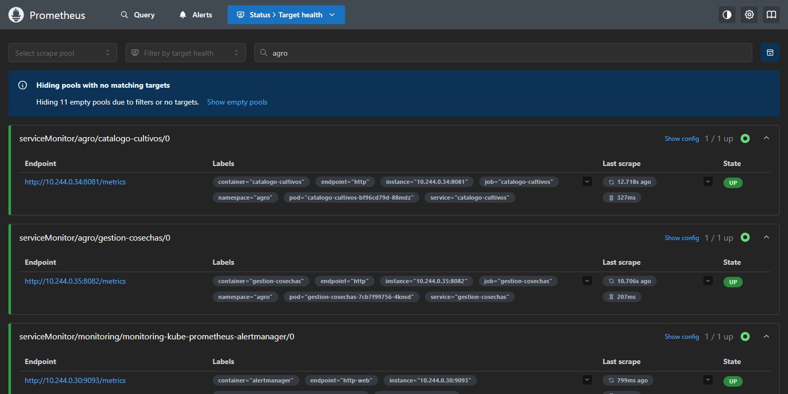

### D2. Dashboard de Grafana funcionando

Dashboard "Agro Monitoring - Cultivos y Cosechas" (18 paneles en 4 secciones). En la captura:
estado de ambos servicios (UP), reinicios de pods, alertas en FIRING, cultivos en catálogo,
delay artificial, tasa de requests por servicio y latencia p50/p95. La caída de tráfico entre
las 22:40 y las 22:48 corresponde al reinicio de Windows que dejó el cluster apagado, no a un
fallo del sistema. El JSON del dashboard está en
[`monitoring/dashboards/agro-monitoring-dashboard.json`](../monitoring/dashboards/agro-monitoring-dashboard.json).

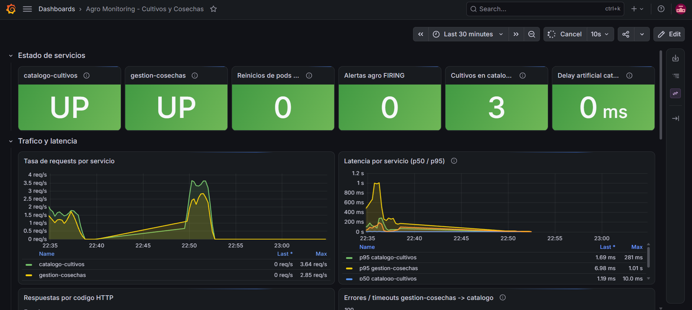

### D3. Pods en estado Running

```text
PS> kubectl -n agro get pods
NAME                                READY   STATUS    RESTARTS      AGE
catalogo-cultivos-bf96cd79d-88mdz   1/1     Running   1 (18m ago)   50m
gestion-cosechas-7cb7f99756-4knsd   1/1     Running   1 (18m ago)   50m
```

El `1 restart` es el reinicio del equipo: Docker Desktop volvió a levantar el contenedor de
Minikube y Kubernetes recreó los contenedores. El listado completo de todos los namespaces
está en [`evidencias/d3-pods-running.txt`](evidencias/d3-pods-running.txt).

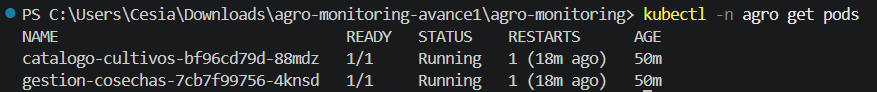

### D4. Alerta en estado FIRING

Las 8 reglas del `PrometheusRule` están cargadas en Prometheus y, con el sistema sano, todas
aparecen **INACTIVE** (estado normal):

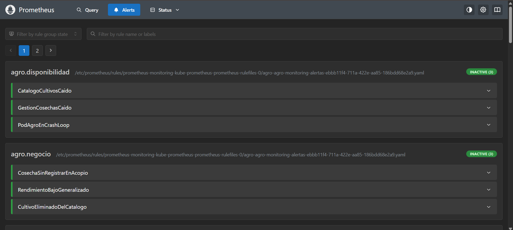

Durante la casuística 1 (CrashLoopBackOff) las alertas `GestionCosechasCaido` y
`PodAgroEnCrashLoop` pasaron a **FIRING**. Salida real de Prometheus y Alertmanager (completa
en [`evidencias/casuistica-1.txt`](evidencias/casuistica-1.txt)):

```text
$ alertas agro (Prometheus /api/v1/alerts)
   FIRING GestionCosechasCaido - gestion-cosechas no tiene instancias UP
   FIRING PodAgroEnCrashLoop - gestion-cosechas esta en CrashLoopBackOff

$ alertas en Alertmanager (http://localhost:30903/api/v2/alerts)
   active PodAgroEnCrashLoop critical
   active GestionCosechasCaido critical
```

Captura de esas alertas en estado **FIRING** durante la casuística 1:


